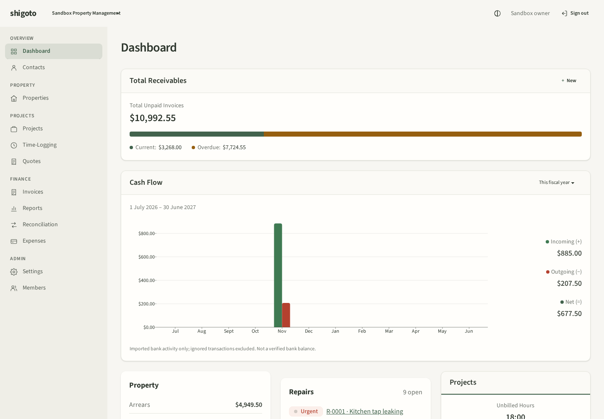
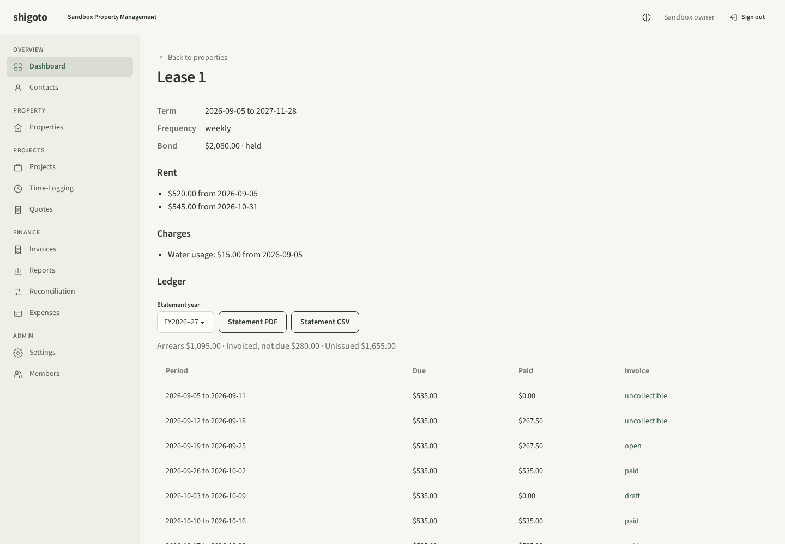
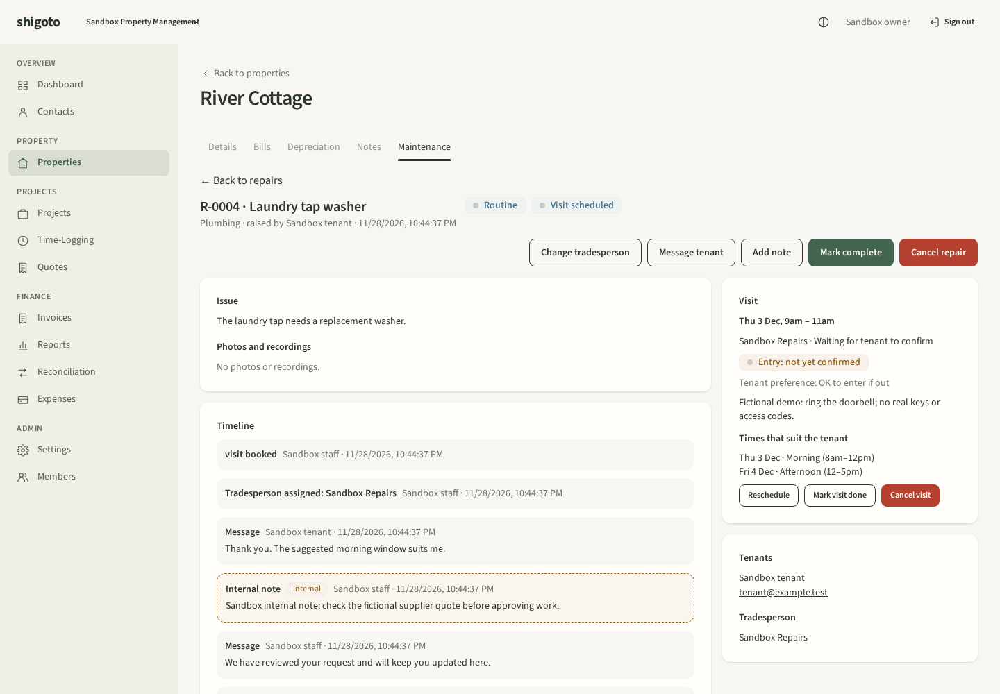
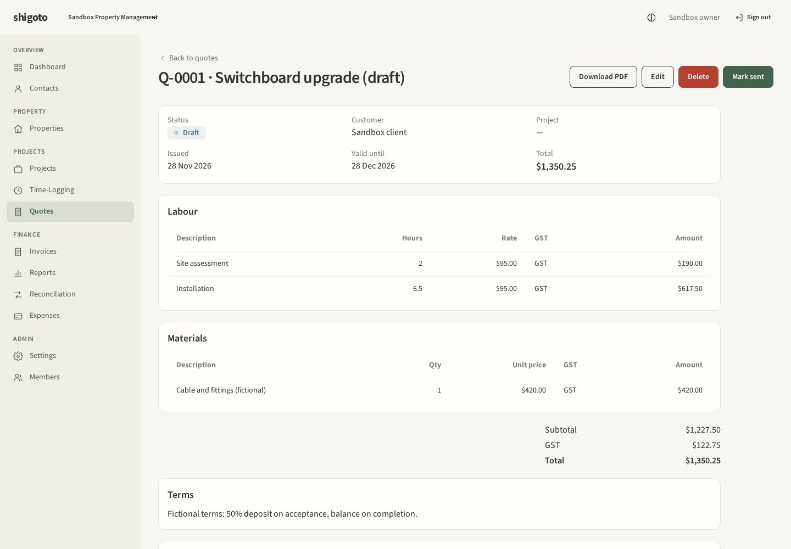
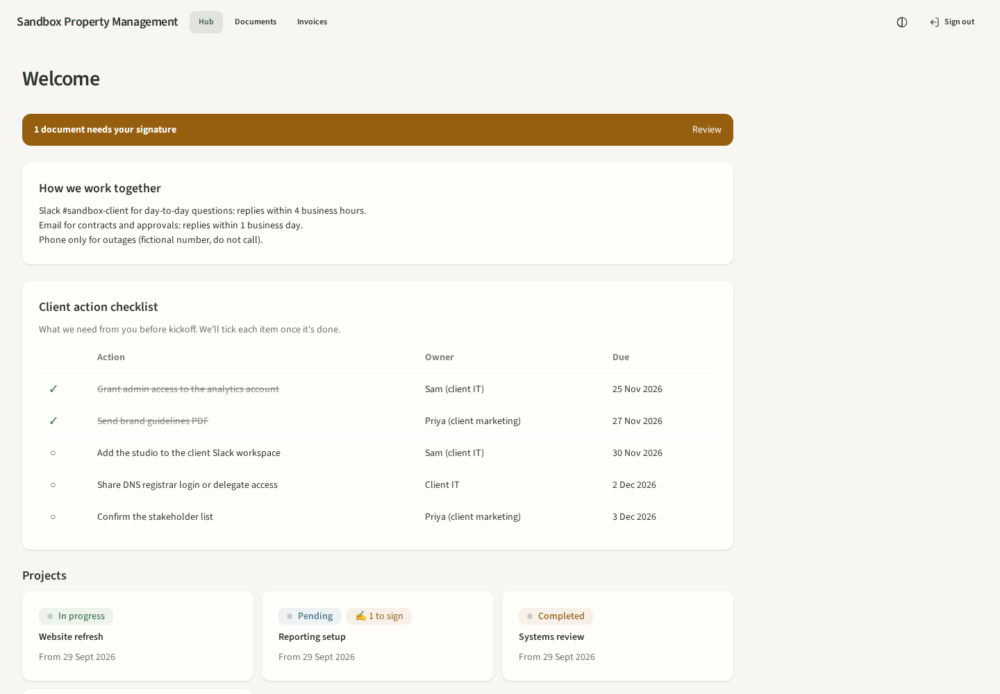

# shigoto

Self-hosted property management, timesheets, quotes and invoicing for small
Australian businesses. One Go binary, an embedded Svelte UI and PostgreSQL.

[](https://github.com/Connor-Ryan-1998/shigoto/actions/workflows/validate.yml)
[](LICENSE)
[](https://github.com/Connor-Ryan-1998/shigoto/releases)
[](https://github.com/Connor-Ryan-1998/shigoto/pkgs/container/shigoto)



## Features

- **Property management:** properties, leases, recurring rent, arrears and rental tax reports.
- **Tenant portal:** rent statements, receipts and repair requests with photos, video and visit consent.
- **Timesheets and quotes:** projects, tasks, billable hours, labour/material quotes and project costs.
- **Invoicing:** GST-aware invoices, PDFs, manual payments and optional Stripe collection.
- **Client portal:** project summaries, shared documents and typed-name signing with an audit certificate.
- **Reconciliation and reporting:** bank CSV imports, expense receipts, cash-basis P&L and BAS summaries.
- **Self-hosted:** multiple organisations, role-based access, optional staff OIDC and passwordless portals.

## Who it's for

Sole traders, small consultancies and self-managing landlords who want their
property and project work in one place, without a stack of SaaS subscriptions.
Australian GST and rental workflows come first.

**Early-stage software, not a full accounting package or tax/legal advice.**
No payroll, live bank feeds or ATO lodgement. Review
[deployment limitations](docs/development.md#pre-deployment-risks) before using real data.

## Quickstart

Requires Git and Docker Compose 2.24.4+. Pulls the published app and builds its
PostgreSQL companion locally; no host Go or Node install needed.

```bash
git clone https://github.com/Connor-Ryan-1998/shigoto.git
cd shigoto
docker compose -f docker-compose.yml -f deploy/compose.images.yml up -d --build --wait db mailpit app

# Bash: choose a password without saving it in shell history.
read -rs -p "Owner password: " OWNER_PASSWORD; printf '\n'
printf '%s\n' "$OWNER_PASSWORD" | docker compose exec -T app /shigoto admin create-owner \
  --org-slug me --org-name "My business" --email me@example.com
unset OWNER_PASSWORD
```

Open **<http://localhost:8080>** and sign in. Development emails appear in
[Mailpit](http://localhost:8025).

**Local development only:** Compose uses development database credentials and
publishes ports. Do not expose this stack to the internet. Back up both PostgreSQL
and uploaded files; older images cannot roll back database migrations.

To build the app from source instead, omit `-f docker-compose.yml -f deploy/compose.images.yml`.
Want fictional data to explore? See [sandbox setup](docs/development.md#populate-local-testing-data).

## Screenshots

Fictional sandbox data only. Click to enlarge.

| Property and rent | Maintenance |
| --- | --- |
| [](docs/screenshots/lease.png) | [](docs/screenshots/maintenance.png) |

| Quotes | Client portal |
| --- | --- |
| [](docs/screenshots/quote.png) | [](docs/screenshots/client-portal.png) |

[Tenant rent portal](docs/screenshots/tenant-portal.png)

## Documentation and contributing

- [Configuration, SSO and email](docs/development.md#configuration)
- [Development and operations](docs/development.md) · [Testing](docs/testing.md)
- [Contributing](CONTRIBUTING.md) · [Interface standards](docs/ui-standards.md)
- [Questions](https://github.com/Connor-Ryan-1998/shigoto/discussions) · [Security](SECURITY.md)

## License

[Apache-2.0](LICENSE) © 2026 Connor Ryan.
